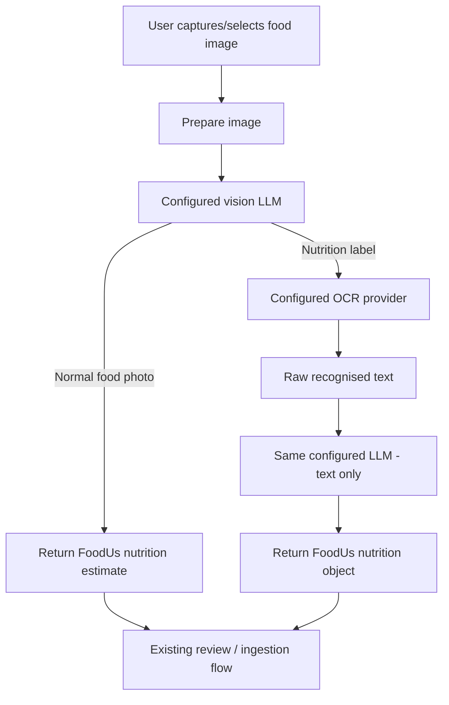

# FoodUs Milestone 2 Addendum — OCR-Assisted Nutrition Capture

**Date:** 25 October 2026  
**Status:** Design addendum  
**Target:** Milestone 2  
**Purpose:** Extend the existing Milestone 2 AI image-ingestion feature with OCR-assisted nutrition-label capture, while preserving the existing AI-only food-photo path.

---

## 1. Purpose

Milestone 2 already introduces AI-assisted food capture: a user supplies a photo, the configured vision-capable LLM analyses it, and FoodUs receives structured nutrition data suitable for the existing calorie/nutrient history.

This addendum enriches that design with a second source of information: **OCR for printed nutrition labels**.

The distinction matters because the two image types have different semantics:

- A photo of a meal has no exact machine-readable source of truth. The AI must identify the food and estimate portions and nutrition.
- A photo of a nutrition-information panel contains explicit printed values. Those values should be read as faithfully as possible rather than estimated.

The resulting design therefore keeps the existing AI system, adds an OCR provider, and routes nutrition-label photos through OCR before the final structured nutrition object is produced.

This is deliberately a small-scale design for FoodUs. It does not optimise for high throughput, enterprise deployment, or future scale.

---

## 2. Decisions Already Made

The following decisions are considered settled for this addendum.

1. **The existing configurable AI endpoint and model remain the only AI endpoint/model configuration.**
   - The same configured model is used for image classification/direct food estimation.
   - The same configured model is used later to convert OCR text into FoodUs nutrition JSON.
   - There is no separate router-model setting.

2. **OCR is a separate provider capability, not a second generic AI endpoint.**
   - OCR gets its own settings sub-page.
   - OCR has its own provider, endpoint and API key configuration.

3. **OCR is not run for every image.**
   - Ordinary meal photos should not incur an OCR call.
   - OCR is invoked only when the first AI call determines that the image is primarily a nutrition-information label.

4. **The first AI call performs two jobs in one request.**
   - Classify the image as a nutrition label or a normal food image.
   - If it is a normal food image, immediately produce the nutrition estimate in the same response.
   - This avoids a dedicated classification call followed by another food-analysis call.

5. **Nutrition-label processing is a three-call pipeline.**
   1. AI image classification.
   2. OCR extraction.
   3. AI text-to-structured-nutrition parsing.

6. **Normal food-photo processing remains a one-call pipeline.**
   1. AI image classification + direct nutrition estimation.

7. **OCR output is treated as extracted source text, not as the final FoodUs data model.**
   - OCR providers return their own OCR response shape.
   - FoodUs extracts the recognised text.
   - The LLM maps that text into the existing FoodUs nutrition schema.

8. **The OCR-to-JSON LLM prompt must not estimate missing values.**
   - It may structure and interpret recognised values.
   - Missing or unreadable information must remain missing rather than being invented.

9. **The existing FoodUs nutrition object remains authoritative.**
   - This feature must not introduce a second nutrition schema.
   - Both the direct-image path and OCR-assisted path converge on the same object that the rest of FoodUs already consumes.

10. **Barcode lookup remains separate and unchanged.**
    - This addendum does not redesign or replace the existing barcode path.

---

## 3. Runtime Architecture

### 3.1 High-level flow



The important architectural property is convergence: downstream FoodUs code should not care whether a `NutritionResult` came from a direct food estimate or from OCR-assisted label parsing.

---

## 4. First AI Call: Classification + Direct Estimate

### 4.1 Responsibility

The initial vision request receives the prepared image and must return one of two logical outcomes:

- `nutrition_label`
- `food_estimate`

For a nutrition label, the response exists only to route the image to OCR.

For a normal food photo, the same response also contains the complete nutrition estimate. No second AI call is made.

Conceptual response contract:

```json
{
  "mode": "nutrition_label | food_estimate",
  "nutrition": "FoodUs NutritionResult or null"
}
```

Rules:

- `mode = nutrition_label`
  - `nutrition` is null.
  - FoodUs proceeds to OCR.
  - The model must not attempt to bypass OCR by reading and returning the label itself.

- `mode = food_estimate`
  - `nutrition` contains the normal structured FoodUs nutrition result.
  - Processing is complete apart from the existing review/history flow.

The exact JSON property names should follow existing FoodUs conventions.

### 4.2 Prompt intent

The vision prompt should make the distinction explicit:

- If the image is primarily a printed nutrition-information panel, classify it as a nutrition label.
- Otherwise, analyse the visible food or drink and return the normal FoodUs nutrition estimate.
- Do not classify incidental text, branding, packaging text or a restaurant logo as a nutrition label merely because text exists in the image.
- Prefer the nutrition-label route when an actual nutritional table/panel is visible and readable enough to justify OCR.

### 4.3 Image preparation

The first request is doing real work for ordinary food photos, so this is no longer merely a tiny low-resolution router image.

Use the existing Milestone 2 image preparation path unless evaluation shows it is inadequate.

Do not hard-code OCR provider upload limits into the generic image pipeline. Provider-specific resizing/compression belongs in the OCR adapter.

---

## 5. OCR Path

### 5.1 Responsibility

When the initial AI response identifies a nutrition label:

1. Send the image to the configured OCR provider.
2. Receive the provider response.
3. Extract the recognised text.
4. Send only that text to the configured LLM.
5. Require the LLM to transform the recognised text into the existing FoodUs nutrition JSON schema.
6. Continue through the same review/history ingestion flow as any other nutrition result.

### 5.2 Internal OCR abstraction

FoodUs should expose OCR internally through a provider-neutral interface.

Conceptually:

```text
OCR Provider
    Input:
        image
        provider configuration

    Output:
        recognised text
        provider processing metadata
        success/failure information
```

The rest of FoodUs should not consume OCR.space-specific response objects.

A provider adapter owns:

- request construction;
- authentication;
- endpoint details;
- provider-specific compression/validation;
- response parsing;
- provider error mapping;
- extraction of raw text;
- provider timing/metadata where available.

This keeps the OCR pipeline testable and allows another provider to be evaluated without changing the feature orchestration.

---

## 6. Initial OCR Provider: OCR.space

OCR.space is the initial reference provider for this milestone.

At the time of this addendum, the documented free POST endpoint is:

```text
https://api.ocr.space/parse/image
```

The API supports multipart file upload. The API key can be sent in the `apikey` request header.

For the initial FoodUs integration:

- use POST;
- upload the prepared image as a file;
- set the language appropriately for the application's expected labels;
- do not request word-coordinate overlay data unless a later requirement needs it;
- extract the recognised text from `ParsedResults[].ParsedText`;
- inspect provider-level and file-level error fields before accepting the response.

The OCR adapter should preserve useful provider metadata such as reported processing time for diagnostics and evaluation, but the application feature only needs the recognised text.

### 6.1 Provider response handling

A successful OCR provider call is not equivalent to a valid nutrition label.

FoodUs must distinguish:

- transport failure;
- provider/API failure;
- OCR parse failure;
- successful OCR with empty or useless text;
- successful OCR with usable label text.

Only usable recognised text should proceed to the LLM parser.

### 6.2 OCR.space references

- API documentation: <https://ocr.space/ocrapi>
- Privacy policy: <https://ocr.space/privacypolicy>

Provider limits and pricing are operational details and may change. They should not be baked into the core FoodUs design.

---

## 7. OCR Text → FoodUs Nutrition JSON

### 7.1 Responsibility

The second LLM request in the label path is a **parser**, not an estimator.

Input:

- the raw OCR text;
- the existing FoodUs nutrition output schema;
- strict parsing rules.

Output:

- exactly the same nutrition object FoodUs expects from the direct vision path.

### 7.2 Parsing rules

The parser prompt must enforce the following:

1. Use only information supported by the OCR text.
2. Do not infer missing nutrient values.
3. Do not invent serving sizes.
4. Preserve the distinction between:
   - per serving;
   - per 100 g;
   - per 100 mL;
   - any other explicit basis present on the label.
5. Preserve units correctly.
6. Do not silently transpose columns from multi-column labels.
7. If a value cannot be determined reliably from the OCR text, return the schema's missing/null representation.
8. Produce only the required structured response.

A particularly serious failure is assigning a correct number to the wrong basis, for example interpreting a `per 100 g` value as `per serving`. Evaluation must score these errors heavily.

### 7.3 Deterministic transformations

Where FoodUs already has deterministic code for unit conversion or normalisation, prefer that code over asking the LLM to perform arithmetic.

The LLM's main job is semantic mapping:

```text
messy OCR text -> known nutrition fields
```

not repairing data or guessing what the label probably meant.

---

## 8. Behaviour When OCR Is Disabled or Unconfigured

OCR is an enhancement to Milestone 2, not a hard dependency on launching the AI feature.

The OCR configuration should have an explicit enabled/configured state.

When OCR is unavailable:

- FoodUs must not attempt an OCR network request.
- The existing AI-only behaviour remains available.
- The UI should make it clear that nutrition-label OCR is not configured rather than failing with a low-level provider error.

When OCR is configured and a label is detected, the OCR path should be preferred because the printed label is the higher-quality source.

---

## 9. Settings UX

### 9.1 Navigation

Add a new sub-page under Settings:

```text
Settings
├── AI
└── OCR
```

The OCR page should be provider-specific in meaning. It should not look like a second generic AI configuration page.

### 9.2 Initial OCR settings

Recommended fields:

- **Enable OCR**
- **Provider**
  - Initial value: `OCR.space`
- **API endpoint**
  - Default: `https://api.ocr.space/parse/image`
  - Editable so the provider endpoint can be changed without a rebuild.
- **API key**
  - Hidden/masked by default.
  - Use the same reveal-eye interaction as the existing AI API-key field.
- **Test OCR configuration**
  - Performs a minimal validation of configuration/provider reachability where practical.
  - Must not expose the API key in UI errors or logs.

Provider-specific implementation settings that do not benefit the user should remain internal defaults rather than cluttering the page.

### 9.3 Credential handling

The OCR API key should follow the same storage and protection mechanism already used for the existing AI key.

Requirements:

- never log the key;
- never include it in evaluation output;
- never include it in exception text presented to the user;
- keep it masked by default in Settings;
- only reveal it after an explicit user action.

The evaluation harness is different: its provider keys should come from environment variables rather than result/config files.

---

## 10. Runtime Failure Behaviour

### 10.1 Initial AI call fails

Use the existing Milestone 2 AI error path.

No OCR request should be attempted because the route is unknown.

### 10.2 Nutrition label detected but OCR request fails

Do not silently manufacture label values.

Return a recoverable OCR error so the user can retry the image/request.

An explicit future UI action may allow the user to fall back to AI-only interpretation, but fallback must not happen invisibly because the whole purpose of the OCR route is to prefer printed source data over estimation.

### 10.3 OCR succeeds but returns insufficient text

Treat this as an OCR extraction failure, not a valid nutrition object.

Examples:

- blank text;
- only a brand name;
- only fragments with no usable nutritional values;
- provider reports success but the recognised text is clearly unusable for the parser contract.

### 10.4 Parser LLM fails

Retain the distinction between:

- OCR successfully extracted text;
- AI failed to map the text into the FoodUs schema.

This distinction is important for debugging and evaluation.

### 10.5 Unexpected structured output

All AI responses continue to pass through the existing structured-output validation.

Invalid JSON or a schema-invalid nutrition object must fail before history ingestion.

---

## 11. Observability

Every external step should have its own timing and result metadata.

For an ordinary food photo:

```text
AI classify + estimate
```

For a nutrition label:

```text
AI classify
OCR extract
AI parse OCR text
```

At minimum record, where available:

- step name;
- provider;
- AI model slug;
- request start timestamp;
- duration in milliseconds;
- success/failure;
- prompt/input tokens;
- completion/output tokens;
- total tokens;
- estimated AI cost;
- OCR provider processing time;
- image byte size supplied to each image-based step.

Secrets must never be logged.

Production logging should avoid unnecessarily persisting user image contents or raw OCR text. The evaluation harness may intentionally persist test-case OCR output because its input images are controlled test fixtures.

---

# 12. Evaluation Harness Addendum

The OCR feature must be evaluated against the same known test data used to compare vision models.

The purpose of the harness is to answer with data:

- Which AI model routes images correctly?
- Which AI model gives the best direct food-photo result?
- How accurate is a given OCR provider on the nutrition labels FoodUs actually sees?
- Does OCR + LLM parsing outperform a pure vision-LLM interpretation of the same label?
- What does each approach cost?
- How long does each approach take?
- Is an OCR provider stable across repeated calls?
- Has accuracy changed after a model, prompt, provider or configuration change?

---

## 13. Evaluation Data Layout

Use:

```text
harness/
└── eval-data/
```

Each eval case gets its own directory.

Initial target: approximately ten cases:

- five nutrition-label images;
- five ordinary food images.

Example:

```text
harness/
└── eval-data/
    ├── 001-energy-drink-label/
    │   ├── image.jpg
    │   └── expected.json
    ├── 002-canned-food-label/
    │   ├── image.jpg
    │   └── expected.json
    ├── 003-sandwich/
    │   ├── image.jpg
    │   └── expected.json
    └── ...
```

The image is the immutable test input.

`expected.json` is the known truth for that case.

It should contain enough information to grade whichever lanes apply to the case, including:

- expected route: nutrition label vs food photo;
- expected structured nutrition values where a true label value exists;
- expected serving/basis information;
- any case-specific scoring metadata.

For ordinary meal photographs, exact nutrition is inherently an estimate. Their ground truth should therefore focus on route correctness and expected structural/semantic behaviour rather than pretending there is an exact nutritional truth where none exists.

---

## 14. Evaluation Lanes

The harness should support separate lanes so different technologies are not accidentally conflated.

### Lane A — Vision model

Tests the configured vision LLM.

Measures:

- label-vs-food classification accuracy;
- direct food estimate output validity;
- structured schema compliance;
- latency;
- token usage;
- cost.

### Lane B — OCR provider

Tests OCR independently.

Input:

- label images only.

Output:

- raw recognised text;
- provider metadata;
- OCR latency.

Measures:

- recovery of known printed facts;
- missing values;
- corrupted numbers;
- unit/basis recognition;
- stability across repeat runs.

There is no token metric for conventional OCR providers.

### Lane C — OCR + LLM parser

Tests the complete label path.

Input:

```text
image -> OCR -> raw text -> LLM -> FoodUs nutrition JSON
```

Measures:

- final structured accuracy;
- OCR latency;
- parser latency;
- parser token usage;
- total end-to-end latency;
- total estimated cost;
- pass/fail score.

### Lane D — Vision-only label baseline

For decision-making, the harness should also be able to send a known nutrition-label image directly to a vision LLM and ask it for the final FoodUs nutrition object without OCR.

This provides the head-to-head comparison the project actually cares about:

```text
pure vision LLM
vs
OCR + LLM parser
```

The comparison can then be based on accuracy, latency and cost rather than assumption.

---

## 15. Harness Runner

Create a PowerShell entry point, for example:

```text
harness/run-eval.ps1
```

It supports two modes.

### 15.1 Config-file mode

If a config file is supplied as an argument, execute without interactive setup.

Configuration may include:

- eval lane;
- AI endpoint;
- model slug;
- OCR provider;
- OCR endpoint;
- pass threshold;
- case filter;
- repeat count;
- cost metadata used for estimates.

Secrets are referenced through environment-variable names, not stored as values in the config.

### 15.2 Interactive mode

If no config file is supplied:

- open a small WinForms UI;
- allow the operator to choose the lane;
- enter/change the model slug;
- choose OCR provider;
- select cases or all cases;
- choose repeat count if desired;
- start the run.

The UI is simply a convenient launcher over the same underlying harness logic. Interactive and config-file runs must execute the same evaluation code.

---

## 16. Result Layout

Use separate top-level categories for model, OCR and combined-pipeline results.

Example:

```text
harness/
└── eval-results/
    ├── models/
    │   └── <model-slug>/
    │       └── <timestamp>/
    ├── ocr/
    │   └── <provider-slug>/
    │       └── <timestamp>/
    └── pipelines/
        └── <pipeline-slug>/
            └── <timestamp>/
```

Use a timestamp rather than only a date so multiple runs on the same day never collide.

Example:

```text
2026-10-25_132215
```

Within a run:

```text
<run>/
├── run-config.json
├── summary.json
├── 001-energy-drink-label/
│   ├── actual.json
│   ├── trace.json
│   ├── grade.json
│   └── ocr.txt
├── 002-canned-food-label/
│   └── ...
└── ...
```

`run-config.json` is a redacted snapshot of the effective configuration.

It must not contain API keys.

---

## 17. Per-Case Trace

Each test case records the external steps it actually executed.

Conceptual trace:

```json
{
  "case": "001-energy-drink-label",
  "steps": [
    {
      "type": "ai",
      "purpose": "classify",
      "model": "model-slug",
      "durationMs": 0,
      "promptTokens": 0,
      "completionTokens": 0,
      "totalTokens": 0,
      "estimatedCost": 0
    },
    {
      "type": "ocr",
      "provider": "ocr-space",
      "durationMs": 0,
      "providerProcessingMs": 0
    },
    {
      "type": "ai",
      "purpose": "parse-ocr",
      "model": "model-slug",
      "durationMs": 0,
      "promptTokens": 0,
      "completionTokens": 0,
      "totalTokens": 0,
      "estimatedCost": 0
    }
  ],
  "endToEndDurationMs": 0
}
```

Use whatever naming style the harness codebase adopts; the important requirement is that metrics exist at **call level**, not only at run level.

---

## 18. Grading

Grading should be a second phase after raw execution.

This separation is intentional:

1. **Run phase**
   - calls providers/models;
   - records actual outputs;
   - does not modify the expected truth.

2. **Grade phase**
   - compares actual output with `expected.json`;
   - writes `grade.json`;
   - contributes to `summary.json`.

This allows scoring logic to evolve without paying to rerun every external model/provider call.

### 18.1 Route grading

Binary and objective:

- expected nutrition label, got nutrition label;
- expected food photo, got food photo.

This can be scored exactly.

### 18.2 Structured nutrition grading

For nutrition-label cases, score fields against known truth.

Examples of fields to grade where they exist in the FoodUs schema:

- serving size;
- energy;
- protein;
- fat;
- saturated fat;
- carbohydrate;
- sugars;
- sodium;
- serving basis;
- per-100 g/per-100 mL basis.

The scorer should distinguish:

- correct;
- missing;
- wrong value;
- wrong unit;
- correct value attached to wrong basis.

Wrong-basis errors should carry a substantially larger penalty than an optional missing nutrient because they can make otherwise plausible-looking data materially incorrect.

### 18.3 OCR-only grading

Do not initially require an exact raw-text string match.

OCR engines can differ in whitespace, punctuation, line breaks and ordering while recovering the important facts correctly.

Instead, grade the OCR result on recovery of known facts from `expected.json`, including:

- expected numeric values;
- units;
- serving size;
- basis labels;
- key nutrient names where useful.

Text normalisation may ignore harmless differences such as repeated whitespace and punctuation.

The raw OCR text must still be saved so failed cases can be inspected manually.

### 18.4 Food-photo grading

A meal photo has no exact nutritional truth unless the test fixture was specially constructed.

Do not pretend estimated calories are objectively correct to the unit.

Score:

- correct routing;
- valid schema;
- sensible presence/absence of required fields;
- failure to hallucinate label-only metadata;
- any deliberately defined broad tolerances for fixtures that have known composition.

### 18.5 Pass threshold

Each run should have:

- per-case score from 0–100%;
- configurable pass threshold;
- overall mean score;
- pass rate.

The raw per-field details must remain available so the overall percentage never hides why a model/provider failed.

---

## 19. OCR Stability Evaluation

OCR provider consistency should be measurable.

The runner should support:

```text
repeatCount = N
```

For OCR lanes, the same image may be submitted repeatedly.

The harness can then report:

- whether the recognised text was identical;
- whether all expected facts were recovered on every run;
- score variance;
- latency variance.

This directly tests the concern that an OCR provider may be noisy or non-deterministic even when average accuracy looks acceptable.

---

## 20. Run Summary

Each run writes `summary.json`.

Recommended aggregate fields:

- subject/model/provider/pipeline identifier;
- timestamp;
- number of cases;
- number passed;
- pass rate;
- average score;
- minimum score;
- total duration;
- average end-to-end latency;
- total AI prompt tokens;
- total AI completion tokens;
- total AI tokens;
- total estimated AI cost;
- OCR call count;
- average OCR latency;
- failures grouped by stage.

For OCR-only runs, token and AI-cost fields are absent or null rather than fabricated.

---

## 21. Head-to-Head Comparison

Create a separate comparison command/script, for example:

```text
harness/compare-evals.ps1
```

The comparison tool reads existing `summary.json` and per-case grade files. It does not re-run providers.

Its purpose is to compare candidates such as:

```text
Model A vs Model B vs Model C
OCR Provider A vs OCR Provider B
Vision-only label parsing vs OCR-assisted parsing
```

Useful comparison dimensions:

- average accuracy;
- pass rate;
- critical error count;
- average latency;
- total/average cost;
- token consumption;
- OCR stability.

The output is evidence for choosing the FoodUs configuration, not a permanent global leaderboard.

The correct choice is the combination that performs best on the application's own representative images at an acceptable cost and response time.

---

## 22. Initial Eval Dataset

The first useful dataset should be intentionally small.

Recommended first set:

### Five nutrition-label cases

Use real examples likely to appear in FoodUs usage, such as:

- canned food;
- bottled or canned drink;
- packaged snack;
- refrigerated packet food;
- another label with a different table/layout.

Prefer images whose printed values can be manually transcribed confidently into `expected.json`.

### Five ordinary food-photo cases

Use visually different examples such as:

- simple plated meal;
- sandwich/burger;
- mixed meal;
- takeaway/fast food;
- another ordinary meal where no nutrition panel is visible.

The first objective is not benchmark prestige. It is a repeatable local regression set representative of how FoodUs will actually be used.

---

## 23. Milestone 2 Acceptance Criteria

### Runtime

- [ ] Existing AI image ingestion remains functional.
- [ ] The first AI image call returns a structured route.
- [ ] A normal food image produces the normal FoodUs nutrition result without an OCR call.
- [ ] A detected nutrition label is routed to OCR.
- [ ] OCR provider output is converted into provider-neutral recognised text.
- [ ] OCR text is sent to the existing configured AI endpoint/model.
- [ ] The parser returns the existing FoodUs nutrition schema.
- [ ] The parser is explicitly prohibited from estimating missing label values.
- [ ] Per-serving and per-100 g/per-100 mL bases are preserved correctly.
- [ ] OCR failure is distinguishable from LLM-parser failure.
- [ ] OCR can be disabled/unconfigured without breaking the existing AI feature.
- [ ] No API key is written to logs.

### Settings

- [ ] Settings contains a dedicated OCR sub-page.
- [ ] OCR provider can be selected/configured.
- [ ] OCR endpoint can be configured.
- [ ] OCR API key can be entered.
- [ ] OCR API key is masked by default.
- [ ] Existing reveal-eye behaviour is reused for the OCR API key.
- [ ] OCR configuration can be validated/tested without exposing the key.

### Evaluation harness

- [ ] `harness/eval-data/` exists.
- [ ] Each eval case contains an image and `expected.json`.
- [ ] Initial corpus contains approximately five label and five food-photo cases.
- [ ] PowerShell runner supports config-file execution.
- [ ] PowerShell runner opens a WinForms launcher when no config is supplied.
- [ ] LLM/API secrets are supplied through environment variables.
- [ ] Results are stored by model/provider/pipeline and timestamp.
- [ ] Raw result generation and grading are separate phases.
- [ ] Each external call records latency.
- [ ] AI calls record available token usage.
- [ ] AI calls record estimated cost.
- [ ] OCR results preserve raw recognised text for eval inspection.
- [ ] OCR-only grading does not rely on exact whitespace/string equality.
- [ ] OCR repeat runs can measure stability.
- [ ] Each run writes a machine-readable summary.
- [ ] Existing summaries can be compared head-to-head without rerunning APIs.

---

## 24. Suggested Story Breakdown

Story identifiers should be adapted to the existing Milestone 2 numbering convention.

### OCR-1 — Define common runtime contracts

- Add the label-vs-food structured response contract.
- Keep the existing FoodUs nutrition result authoritative.
- Define provider-neutral OCR result/error types.

### OCR-2 — Add OCR settings page

- Provider selector.
- Endpoint.
- API key.
- Mask/reveal behaviour.
- Enable/disable state.
- Configuration test.

### OCR-3 — Implement OCR.space adapter

- POST image.
- API-key authentication.
- Response/error parsing.
- Extract `ParsedResults[].ParsedText`.
- Provider-specific image preparation.

### OCR-4 — Update the first AI image request

- Classify nutrition label vs food.
- Return direct nutrition estimate for food photos in the same call.
- Route label photos without attempting a final label interpretation.

### OCR-5 — Implement OCR-text nutrition parser

- Text-only LLM request.
- Strict no-estimation prompt.
- Existing FoodUs schema output.
- Basis/unit preservation.

### OCR-6 — Orchestrate the end-to-end flow

- One-call food path.
- Three-call label path.
- Error propagation.
- Existing review/history integration.

### OCR-7 — Build eval dataset and PowerShell runner

- `harness/eval-data`.
- Initial ten cases.
- config-file mode.
- WinForms interactive mode.
- environment-variable secrets.

### OCR-8 — Add grading, metrics and comparison

- raw result capture;
- trace files;
- token/cost/latency metrics;
- route grading;
- structured nutrition grading;
- OCR fact-recovery grading;
- stability repeats;
- summaries;
- head-to-head comparison.

---

## 25. Explicit Non-goals

This addendum does **not** include:

- redesigning barcode lookup;
- automatically calling OCR for every image;
- a second generic AI endpoint;
- a dedicated classifier model configuration;
- enterprise OCR requirements;
- high-volume scaling work;
- queues, batching or throughput optimisation;
- OCR of arbitrary documents as a general FoodUs feature;
- receipt parsing;
- menu parsing;
- replacing the existing FoodUs nutrition schema;
- allowing OCR to directly define an arbitrary application response schema;
- treating model/provider benchmark results from the wider internet as more important than the FoodUs eval corpus.

---

## 26. Outcome

After this addendum is implemented, Milestone 2 will support two deliberately different evidence paths:

```text
Meal photo
    -> vision LLM
    -> estimated FoodUs nutrition data

Nutrition label
    -> vision LLM route decision
    -> OCR
    -> recognised source text
    -> LLM structural parser
    -> label-derived FoodUs nutrition data
```

The accompanying harness makes the architectural choice measurable.

FoodUs will be able to compare:

```text
pure vision AI
vs
OCR provider quality
vs
OCR + AI parsing
```

using the same representative images, known truth, grading rules, latency measurements, token usage and cost data.

That gives Milestone 2 a repeatable, data-backed way to choose both the AI model and the OCR approach instead of relying on intuition.
